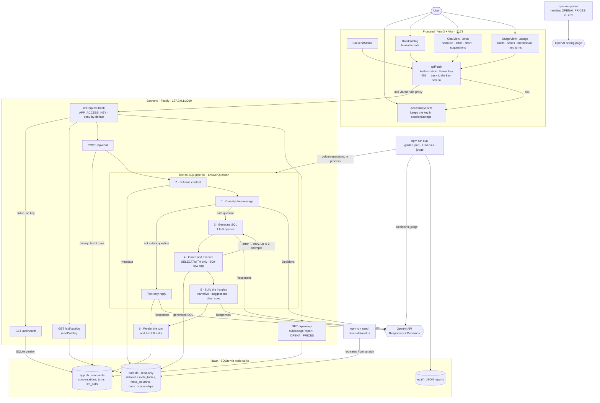

# Architecture diagram

A map of the components described in [ARCHITECTURE.md](ARCHITECTURE.md) and how they
connect. The step numbers are the pipeline's steps in that file. When a component, route or
step changes there, change it here too.

