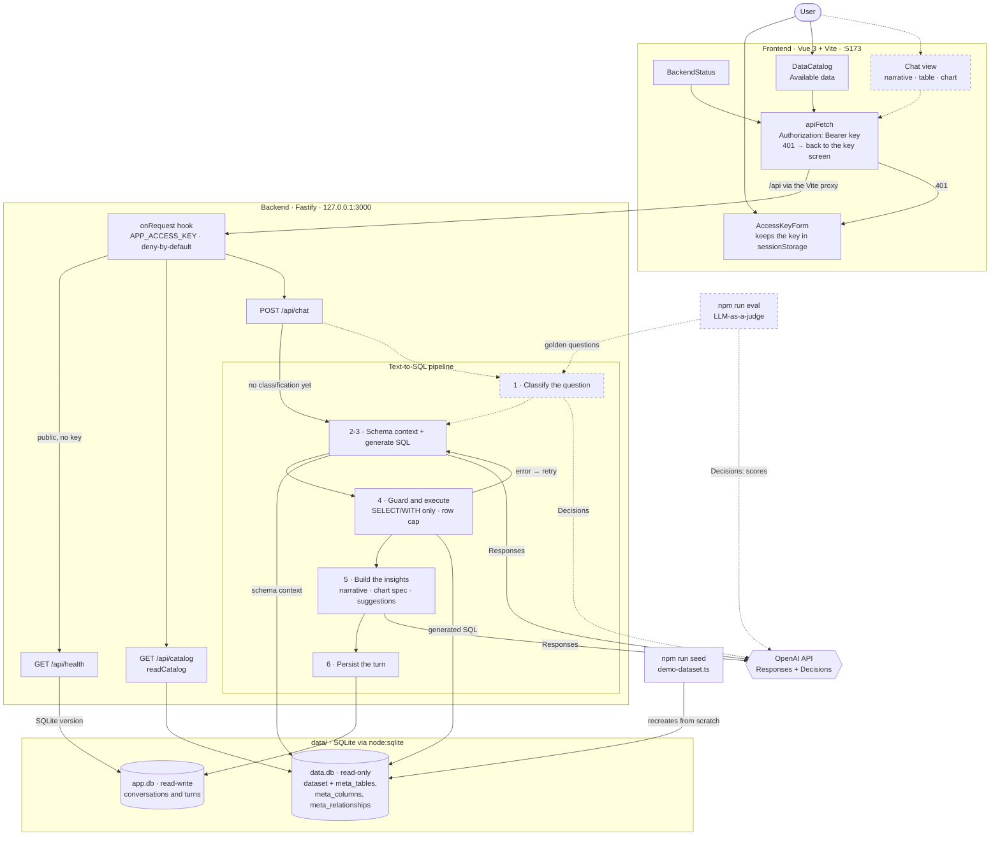

# Architecture diagram

A map of the components described in [ARCHITECTURE.md](ARCHITECTURE.md) and how they
connect. Solid lines are built; dashed lines are planned in the epic
([issues/1-poc-chatbot-text-to-sql.md](../issues/1-poc-chatbot-text-to-sql.md)). When a
planned piece lands, make its arrows solid and remove it from the `planned` class.

